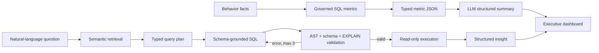

# System Architecture

## Overview

Pulse is a merchant intelligence application with two complementary paths:

1. A governed behavior pipeline computes portfolio KPIs from view, click, wishlist, and booking facts.
2. A plan-first NL-to-SQL agent answers ad-hoc questions over merchant, performance, interaction, and behavior data.



## SQL generation pipeline

### 1. Schema introspection

`SchemaCatalog` reads tables, columns, types, and foreign keys directly from SQLite. Prompts receive only the relevant portion of this catalog, reducing hallucinations and prompt size.

### 2. Semantic retrieval

The retriever adds metric definitions, business thresholds, playbooks, and verified query examples. OpenAI embeddings are used when configured; TF-IDF provides an offline fallback.

### 3. Typed query planning

Before SQL is written, the planner returns a `QueryPlan` containing:

- intent;
- tables;
- dimensions and metrics;
- filters and time grain;
- sorting and row limit;
- explicit assumptions.

This separates semantic interpretation from SQL syntax and creates an inspectable contract for validation.

### 4. Structured SQL generation

The generator returns a `QueryDraft` with SQL and rationale. Its prompt enforces explicit joins and columns, aggregate-safe ratios, ISO dates, bounded result sizes, and the SQLite dialect.

### 5. Validation and repair

Every draft passes four gates:

1. `read_only_ast`: SQLGlot confirms a single `SELECT`/`WITH` statement and rejects DDL/DML.
2. `schema_grounding`: referenced physical tables must exist and be present in the query plan.
3. `explicit_columns`: `SELECT *` is rejected.
4. `sqlite_explain`: SQLite compiles the query with `EXPLAIN QUERY PLAN` before execution.

Validation or execution errors are fed back to the generator. LangGraph allows at most three attempts before returning a safe error response.

### 6. Read-only execution

SQLite is opened with `mode=ro`, queries are capped at 200 rows, and the model never receives a direct database connection.

## Structured outputs

- `QueryPlan`: semantic query contract
- `QueryDraft`: SQL plus generation rationale
- `ValidationReport`: checks, normalized SQL, error, and explain plan
- `InsightResponse`: headline, KPIs, findings, chart spec, actions, confidence, and caveats
- `BehaviorSummary`: governed executive narrative, opportunities, and risks

## Evaluation

`evals/sql_questions.json` covers trends, joins, rankings, funnels, and behavior metrics. The evaluator verifies successful compilation plus required tables and output columns.

```bash
PYTHONPATH=. python scripts/evaluate_sql_agent.py
pytest -q
```

## Production evolution

- Replace SQLite with a warehouse read-only role and dialect-specific compiler.
- Enforce tenant predicates outside the model-generated query.
- Persist embeddings in pgvector or a managed vector store.
- Add golden SQL, execution-result, and answer-faithfulness evaluations.
- Record prompt, plan, validation, latency, token, and repair metrics in LangSmith/OpenTelemetry.
- Add human approval for recommendations that trigger merchant-facing actions.

